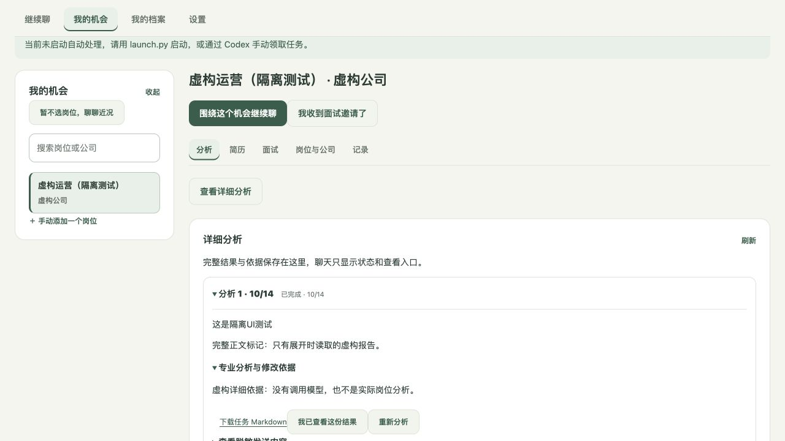

# RC4.3.40 审阅复现与源码修复报告

日期：2026-10-14（Asia/Shanghai）。对象：`仓库根目录`。本轮依据用户的新授权复现并修复审阅问题，未增加求职业务功能、升级应用版本、重建 ZIP 或发布。当前仍是本机验收修订候选，不是正式 v1。

应用版本仍为 `1.0.0-rc.4.3.40`，扩展 manifest 版本仍为 `1.0.0.45`。**源码现在与 10 月 8 日归档 ZIP 不同；旧 ZIP 不含本轮修复。** 三个 ZIP、原验收报告和截图的 SHA-256 仍与原清单一致，旧候选及用户运行目录均未覆盖。

## 复现结论与处理

审阅文件是第三方材料，其建议不自动构成发布、迁移、登录、签名或修改宣传片的授权。原脚本先读后运行，全部指定本轮源码路径，仅使用临时虚构档案、假模型或 localhost 假服务。

| 编号 | 本轮结论与处理 | 验收边界 |
| --- | --- | --- |
| B1 | 按 Apple 官方流程改安装说明；便携运行时损坏时停止，不回退触发系统 Python/开发工具安装；去掉 Codex 私有缓存备选解释器 | 隔离源码启动与损坏运行时检查通过。浏览器下载、Gatekeeper、签名和公证仍未实测/完成 |
| B2 | 未修改或投放报告所述 Clawd 宣传片 | 尚无可编辑素材路径或许可选择；角色授权未核实 |
| H1 | 复现 Codex 普通聊天误建任务；改为保守本机意图判断，排除引用、否定、第三方、假设、提问及暂缓；有效 API chat 判定仍不建任务 | 原 01 脚本的五条讨论均为 companion_chat，明确分析仍建一个 analyze_job，随后简历请求可建单 |
| H2 | 复现长成果令普通 API 对话失败；快照改为有界成果目录，所选成果保留准确 ID、脱敏内容、过期标记并限长 | 原 02 三句均 done；长历史及精确引用回归通过。未新增删除成果入口 |
| H3 | 确认旧环境继承和工具开放；Codex 环境改白名单，禁 shell/image/连接器/插件/浏览器/协作/搜索/MCP，输出增加配置密钥及常见 token 兜底 | 本机真实 CLI 对 localhost 假 Responses API 的实际工具清单无本机读取/执行工具；没有调用真实模型或读取认证 |
| M1 | 复现未认证 GET 可读资料及写令牌；除公开 health 外，API 读端需本机授权，启动片段一次性交换后使用本机 token/HttpOnly cookie | 原 04 的资料导出和 session 均为 403；伪造 same-origin 请求头也取不到资料或 token；跨站和根导航边界保留 |
| M2 | 补常见微信/QQ、全角号码/邮箱、居住与证件标签；收窄错误匹配，保留 JD 工作地址 | 原 03 的 14 条全部 OK。脱敏规则版本更新使旧批准失效，仍需人工核对；不承诺全部自由文本匿名 |
| M3 | manifest 加有效固定公钥，桥接仅接收派生固定 ID；确认信息给出完整名/ID及读写范围 | OpenSSL 独立校验 SHA-256 派生 ID；陌生扩展被拒。没有实际安装或重载用户扩展 |
| M4 | 复现取消/超时竞争及失败落库异常杀死 worker；补安全失败记录、循环恢复和 active 清理 | 原 06 两线程均存活；原脚本第二任务使用 /bin/true 而失败，不能称为生成成功。新增回归另外证实下一任务 done |
| M5 | 规范化 JSON 包装、字段长度与追问数量，保留必填及类型校验 | 原 07 的额外追问、520 字 decision、JSON 前说明均 done；缺 summary 和错误类型仍 failed |
| M6 | DOCX 只提外层段落，排除兼容副本与删除修订，保留 tab/br、读取页眉页脚；回填姓名按字段边界拆分、邮箱限 ASCII | 虚构 DOCX 各结构、姓名/电话/邮箱回填直接检查通过；不扩大为所有 Word 模板都正确 |
| M7 | 本机资料副本添加用户原话列表，不输出完整任务上下文或领取 token | 原 08 的面试回忆与聊天原话均在副本；接入配置密钥未导出 |
| M8 | 隐藏时停轮询，避免重叠，空闲降低频率；state 用限长摘要与 ETag，准确任务全文在展开时读取；HR 缓存只在明确消息区变化时复用 | 500 份虚构报告的摘要 JSON 小于 700 KB，不含正文；精确展开与简历草稿回归通过。未做真实招聘页性能实测 |
| M9 | Mac 构建白名单仅保留运行代码与用户文档，补隐私及许可状态；源码包保留工程资料和开发测试依赖声明 | 白名单隔离复制检查通过，未生成新包。报告“缺件”对应不同目录；指定最新归档实际有三个 ZIP、报告、清单和截图。项目许可尚未选定 |
| M10 | 取消默认 Codex 私有缓存运行时来源，构建需显式指定；启动脚本去掉该私有路径 | 既有 ZIP 二进制没有替换，签名/来源/第三方再分发材料仍待完成 |
| M11 | 扩展名称改为“求职搭子侧栏”，README 增加平台协议核对提示 | 未据公开转述断言必然封号或平台已授权，现行条款需自行核对 |
| L1 | GET 增加有界错误响应，控制字符清理，不支持的 PDF 字体返回可操作的 503 | 畸形 URL 不断连；DOCX 控制字符导出及模拟 CFF 字体错误检查通过 |
| L2 | 默认不再固定 gpt-5.6-luna，使用当前 CLI 内置默认；明确参数/环境选择仍优先 | 假 CLI 参数回归通过，未实际评审新默认模型的质量或延迟 |
| L3 | 旧快照资料变化后拒绝重试，并提示重新确认脱敏、创建新任务，保留原记录 | 隔离 stale retry 回归通过，不悄悄重建历史快照 |
| L4 | 权限加密 PDF 先尝试空用户密码，真正需要密码时保持拒绝 | 虚构权限密码 PDF 可解析；未读取真实 PDF |
| L5 | TXT UTF-8 解码失败后尝试 GB18030 | 虚构 GB18030 文本检查通过 |
| L6 | 服务与存储统一 5000 字，工作台及侧栏输入上限同步 | 边界回归通过 |
| L7 | 嵌套 JSON 深度与编号/类型检查，畸形请求返回 400 | 隔离 HTTP 回归通过 |
| L8 | 不同有效 JD 候选拒绝，同一嵌套正文合并，确认前显示有限预览及字数 | 合成 DOM 回归通过，不替代招聘实站 |
| L9 | 服务版本从 manifest 读取；侧栏在配对及发送前核对版本 | 版本不符拒绝的合成回归通过；没有改应用版本号 |
| L10 | 固定配对端口；随机 nonce + 配对 token 的 HMAC-SHA256 先证明服务身份，再发送 token/页面或用户内容 | 同版假服务及旧 nonce 重放均只收到匿名 challenge，收不到 JD/HR/用户原话或 token；正确证明后调用可用 |
| L11 | 改掉本轮触及的“通道”、预算、IncompleteRead、退出码等错误文案，并给出下一步 | 没有为此重写全部历史 UI 文案 |
| L12 | 初始化时收紧选定资料目录到 0700；API 授权已收紧 | 没有迁移钥匙串，数据库仍不是加密保险箱；未操作真实目录权限 |
| L13 | 声明现有 jsdom 开发依赖与 Node 测试命令；新增改动按必要范围排版 | 未安装新依赖，没有全库格式化或重构 |

## 本轮验收证据

- 主代理全量 Python：**276/276**，46.208 秒，含 RC release/transport、公司、授权、桥接、锁、对话及新增审阅回归。
- 主代理全量 Node：**158/158**，2.811 秒，0 失败。随后收窄消息区缓存规则，相关 chat_context **13/13**；最终文案调整后 workspace **48/48**、Python 对话/companion **70/70**。
- 既有检查使用 Python 3.12.14 验证运行时及 Node v24.19.0；验证解释器来自 RC4.3.27 包，不代表当前产品版本。Node 只使用已安装的 jsdom 26.1.0，没有执行安装或外网模型调用。
- 原脚本 01/02/03/04/06/07/08 修复后由主代理复跑。05 在新授权协议下旧取 token 方法失效；临时适配后陌生申请被拒，而其“申请必成功”的旧假设导致 KeyError，不能写成原脚本完整 0 退出。
- 09 在本机因 Python 路径含空格导致假可执行文件 shebang 失效，仅在内存修正夹具后复验：stdin 中仍有不可信 JD 标记，它仅为数据；环境 OPENAI_API_KEY 不再传入。原附件文件未修改。
- 主代理复跑真实本机 CLI 的 localhost 合成 provider 探测：工具只有 request_user_input/get_goal/create_goal/update_goal；无 shell、exec_command、write_stdin、view_image、协作、MCP、搜索或浏览器。假服务没有完整 SSE，CLI exit 1，证据只证明实际发出的工具清单，不证明真实模型任务完成。
- 实际 IAB：隔离虚构工作台启动片段移除、授权后刷新、自动刷新保留未保存表单；最新源码的精确任务深链接读取完整正文及依据通过。该页结果来自假夹具，没有调用模型，不是招聘实站或产出质量验收。
- Mac 启动脚本在隔离源码目录启动、健康版本及资料目录 hash 核对、未认证读取 403 通过；损坏 runtime 不回退系统解释器。没有重建或重新验收下载后的 ZIP。

临时日志：`本机临时日志路径（未随仓库提供）`、`本机临时日志路径（未随仓库提供）`；可能被系统清理，不能作为长期唯一证据。

## 历史真实验收与未验证范围

10 月 8 日 Edge、两个 BOSS 独立岗位页、Codex 任务 126.108/132.648 秒、实际 Word/PDF 导出，以及前轮有赞公开来源检索属于历史限定证据。本轮未重放这些真实模型/招聘站/联网过程，不将旧速度保证用于当前 CLI 默认模型。

仍未完成：干净 Mac 浏览器下载后的 Gatekeeper 流程、签名/公证、运行时替换及许可材料、项目许可选择、宣传片素材及角色许可；真实 HR 关联、多平台/版式、Tavily 和新默认模型质量/延迟仍待明确范围验收。没有读取、删除、迁移或打包真实资料、简历或凭据，没有终止用户服务、发送 HR 或投递；仅结束本轮自建的隔离测试服务。

不采纳需要扩大产品范围的建议：单份成果删除入口、凭据钥匙串迁移、签名安装器、多配对管理界面或全库重构。本轮通过修复原因消除对应代码问题，其余事项维持待确认。

实际分工：主代理保持用户选择的模型，负责范围、服务/worker 修复、源码及证据复核、真实 IAB 检查与交付；两名 **gpt-6-luna / high** 子代理分别处理对话/扩展、脱敏/文档/导出与限定回归、CLI 工具和服务证明核查，没有下级代理。主代理检查实际文件、复跑原复现与关键回归，未只凭完成声明验收。

安装说明依据 [Apple 官方安全打开说明](https://support.apple.com/zh-cn/102445)；CLI 工具设置参照 [OpenAI 官方配置文档](https://learn.chatgpt.com/docs/config-file/config-reference)，但以本机捕获的实际清单为准；平台使用条款查看 [BOSS 官方协议入口](https://about.zhipin.com/agreement)。
